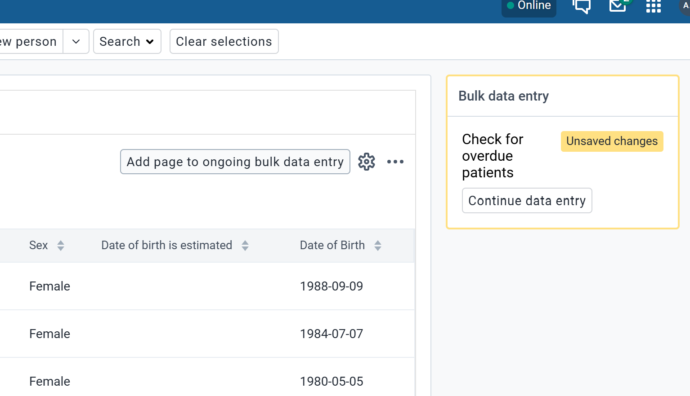
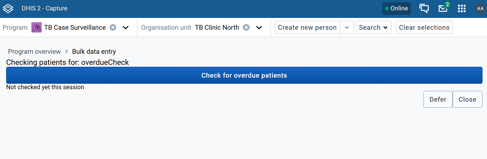
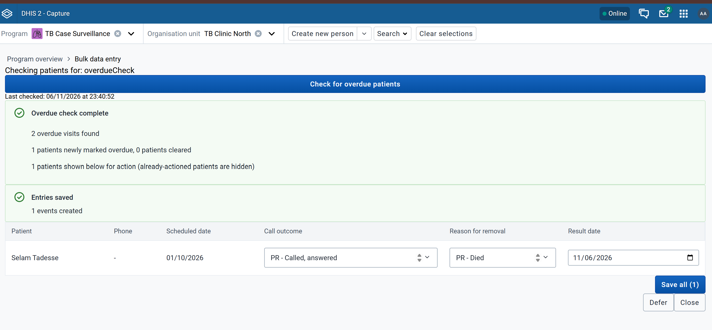
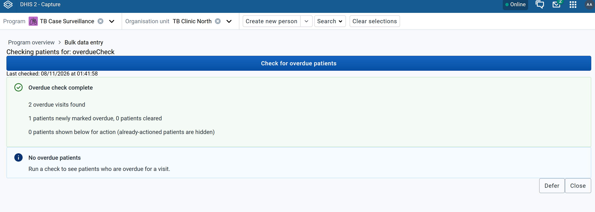

# Patient Recall Plugin for DHIS2 Capture

A [Bulk Data Entry plugin](https://developers.dhis2.org/docs/capture-plugins/developer/bulk-data-entry-plugin/introduction/) for the DHIS2 Capture app that helps health workers find patients who have missed a scheduled visit, and record the outcome of a follow-up call for many patients at once.

It was built for patient recall workflows in NCD programs (for example, hypertension follow-up), where overdue patients are normally flagged by a nightly SQL job. The plugin does the same work on demand, inside Capture, using only the standard DHIS2 Tracker API. No server-side scripts or SQL views are needed.

> **Status:** prototype. Tested on DHIS2 2.42.4 with a TB Case Surveillance demo program. Try it on a test instance before you use it in production.

## What it does

When a user clicks **Check for overdue patients**, the plugin:

1. Finds every scheduled visit in the configured program stage that is past its due date (event status `OVERDUE`) across the user's accessible org units.
2. Sets a "patient status" tracked entity attribute to _overdue_ for those patients, and clears it for patients who are no longer overdue. You can then filter a normal Capture working list on that attribute.
3. Lists the overdue patients (name, phone number and scheduled date), sorted by scheduled date. Patients who have already been called since their last visit are hidden, so nobody is called twice.
4. Lets the user record a **call outcome** for each patient. A **reason for removal** dropdown is shown only when the call was answered. **Save all** creates one event per patient in a single import.

It also shows when the check last ran. The check never runs automatically, because it can be slow on a large org unit tree.

## Using the plugin

**1. Open the plugin.** In Capture, select the program and an org unit. Under **Bulk data entry** in the right-hand sidebar of the Program overview page, choose **Check for overdue patients**. If you left the plugin with **Defer** earlier, click **Continue data entry** instead.



**2. Run the check.** Click **Check for overdue patients**.



**3. Record call outcomes.** A summary shows how many overdue visits were found and how many patients were flagged or cleared. Choose a **Call outcome** for each patient you called. If the call was answered, a **Reason for removal** dropdown appears. Adjust the date if needed, then click **Save all**. Rows without an outcome are skipped.



**4. Check the result.** Run the check again. Patients who were just called no longer appear in the list. Saving sets their status attribute to `calledValue`. While their scheduled visit is still outstanding, the next check flags them as overdue again, but they stay hidden from the list.



**Defer** leaves the plugin and keeps its place in the sidebar. **Close** ends the session.

## Requirements

- A DHIS2 version whose Capture app supports Bulk Data Entry plugins: 2.40.9, 2.41.5, 2.42.1, 2.43 or later. Only 2.42.4 has been tested.
- A tracker program with:
    - a program stage holding the scheduled visits to check (for example "Treatment episode" or "HTN visit")
    - a program stage for recording calls, which can be the same stage used for data entry
    - a tracked entity attribute for the patient status flag, either BOOLEAN or TEXT with an option set
    - attributes for given name, family name and phone number
    - a data element with an option set for the call outcome, and optionally a second one for the reason for removal
- A user with the **App Management** authority to install the app, and access to edit the `capture` datastore namespace.

## Installation

### 1. Install the app

Download the `.zip` from the [Releases](../../releases) page, or build it yourself:

```sh
pnpm install
pnpm build        # creates build/bundle/patient-recall-plugin-<version>.zip
```

In DHIS2, open **App Management**, choose **Manual install**, and upload the `.zip`. The plugin is then served at:

```
https://<your-instance>/api/apps/patient-recall-plugin/plugin.html
```

### 2. (Optional) Import example metadata

[`metadata/example-call-outcome-metadata.json`](metadata/example-call-outcome-metadata.json) contains two example data elements with their option sets:

| Data element                              | Options                                                                                         |
| ----------------------------------------- | ----------------------------------------------------------------------------------------------- |
| PR - Call outcome                         | Called, answered · Called, no answer · Invalid or wrong number                                  |
| PR - Reason for removal from overdue list | Agreed to visit · Already visited · Transferred · Moved away · Died · Refused to return · Other |

Import the file with the **Import/Export** app (metadata import), then add both data elements to your call stage in the **Maintenance** app. If your program already has call-outcome data elements, skip this step and use their IDs instead.

### 3. Configure the plugin in the datastore

Capture finds Bulk Data Entry plugins through the `capture` → `bulkDataEntry` key in the datastore. This plugin reads its own settings from the same entry. The Tracker Plugin Configurator app doesn't support Bulk Data Entry plugins, so edit the key with the **Datastore Management** app (or the API).

Create the key if it doesn't exist, then add an entry to its `config` array. [`metadata/example-datastore-config.json`](metadata/example-datastore-config.json) is a complete example. Replace the IDs with your own program's IDs and `<your-instance>` with your server URL.

| Field                                                               | Required | Description                                                                                                                                                                             |
| ------------------------------------------------------------------- | -------- | --------------------------------------------------------------------------------------------------------------------------------------------------------------------------------------- |
| `title`, `configKey`, `programId`, `pluginSource`                   | Yes      | Standard Capture fields ([docs](https://developers.dhis2.org/docs/capture-plugins/developer/bulk-data-entry-plugin/manual-setup/)). `pluginSource` must be the `plugin.html` URL above. |
| `programStageId`                                                    | Yes      | Stage whose overdue scheduled events mark a patient as overdue. Its latest completed event counts as the patient's last visit.                                                          |
| `overdueAttributeId`                                                | Yes      | Tracked entity attribute used as the patient status flag.                                                                                                                               |
| `overdueValue`                                                      | Yes      | Value written when a patient is overdue (e.g. `true`, or an option code such as `OVERDUE_PENDING_CALL`).                                                                                |
| `clearedValue`                                                      | Yes      | Value written when a patient is no longer overdue.                                                                                                                                      |
| `calledValue`                                                       | Yes      | Value written when a call is saved for a patient (e.g. `CALLED`; for a BOOLEAN attribute usually the same as `clearedValue`).                                                           |
| `givenNameAttributeId`, `familyNameAttributeId`, `phoneAttributeId` | Yes      | Attributes shown in the patient list.                                                                                                                                                   |
| `callEventStageId`                                                  | Yes      | Stage that counts as "already called". A patient with an event in this stage after their last visit is hidden from the list.                                                            |
| `bulkEntryStageId`                                                  | Yes      | Stage where **Save all** creates events. Usually the same as `callEventStageId`.                                                                                                        |
| `resultDataElementId`                                               | Yes      | Data element with an option set for the first dropdown (call outcome).                                                                                                                  |
| `resultDateDataElementId`                                           | No       | DATE data element that receives the row's date.                                                                                                                                         |
| `reasonDataElementId`                                               | No       | Data element with an option set for the conditional second dropdown (reason for removal).                                                                                               |
| `reasonShowWhenResultCode`                                          | No       | Call outcome option code that shows the reason dropdown (e.g. `ANSWERED`).                                                                                                              |

To use the plugin in more than one program, add one entry per program, each with its own `configKey`. No code changes are needed.

### 4. Check it works

Open Capture, select the program and an org unit, and the plugin should appear under **Bulk data entry** in the sidebar.

## Development

```sh
pnpm install
pnpm start     # standalone preview (src/App.tsx) against a DHIS2 instance
pnpm test      # Jest + Testing Library
pnpm lint
```

`d2.config.js` defines two entry points: `app` (`src/App.tsx`), a standalone preview harness, and `plugin` (`src/Plugin.tsx`), the page Capture loads in an iframe.

| Path                                                 | Purpose                                                               |
| ---------------------------------------------------- | --------------------------------------------------------------------- |
| `src/Plugin.tsx`                                     | Plugin UI and wiring                                                  |
| `src/hooks/usePluginConfig.ts`                       | Reads this plugin's entry from `capture/bulkDataEntry` by `configKey` |
| `src/hooks/useOverdueCheck.ts`                       | Overdue query, "already called" filter, status attribute write-back   |
| `src/hooks/useBulkStageEntry.ts`                     | Bulk event creation for the call stage                                |
| `src/hooks/useProgramStageCompulsoryDataElements.ts` | Finds compulsory fields the form doesn't collect                      |
| `src/components/OverduePatientList.tsx`              | Patient table with call outcome / reason / date inputs                |

## Known limitations

- The status attribute only changes when someone runs the check. It is not a live overdue flag.
- The overdue query uses `ouMode=ACCESSIBLE` (everything the user can capture data for), not just the selected org unit. On DHIS2 2.42.4, `ouMode=DESCENDANTS` on `/api/tracker/events` returned no events.
- Any call event after the last visit hides the patient from the list, including "no answer" outcomes.
- If the call stage has compulsory DATE fields the form doesn't show, they are filled with the row's date. Other compulsory field types are not collected: the plugin shows a warning and the import may fail.
- Settings are edited as JSON in the datastore. There is no settings screen in the plugin.

## Background

Capture working lists can filter on event status within one program stage. They can't combine conditions across stages, such as "overdue in the visit stage _and_ not yet called in the call stage" ([community thread](https://community.dhis2.org/t/working-lists-across-program-stages/57319)). This is why packages such as the [Simple hypertension package](https://github.com/simpledotorg/dhis2-hypertension-package/blob/main/doc/installation_guide.md#triggers-for-tracked-entity-attribute-updates) keep a patient status attribute up to date with nightly SQL jobs. This plugin keeps that attribute up to date from inside Capture instead, whenever a user runs the check.

## License

[BSD-3-Clause](LICENSE)
